# [SAR Imaging] MIMO SAR RDA Imaging in Low Oblique Scenes [with MATLAB Code]

SAR signal properties  
Range-Doppler algorithm (RDA)  
MATLAB simulation results

## Images

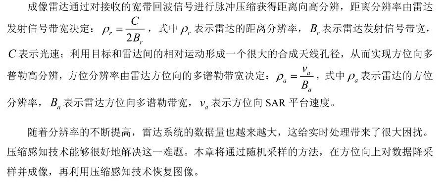
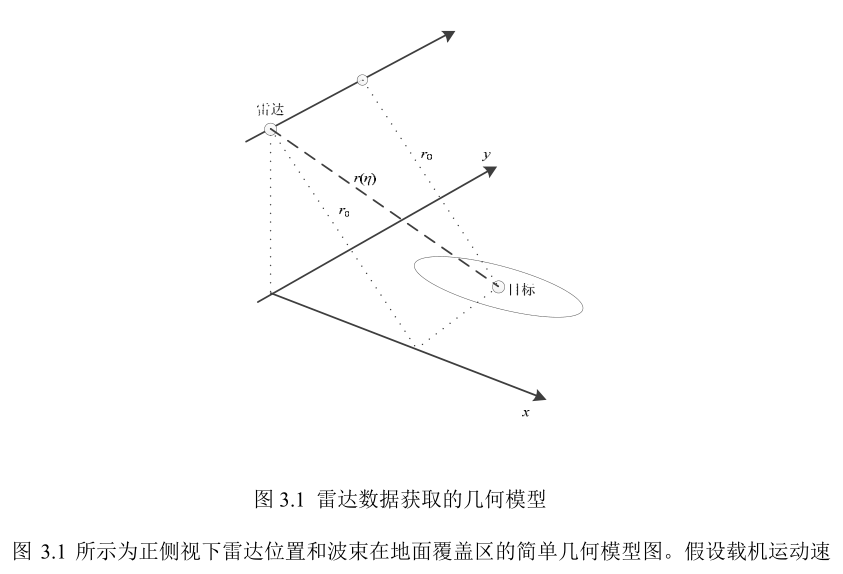
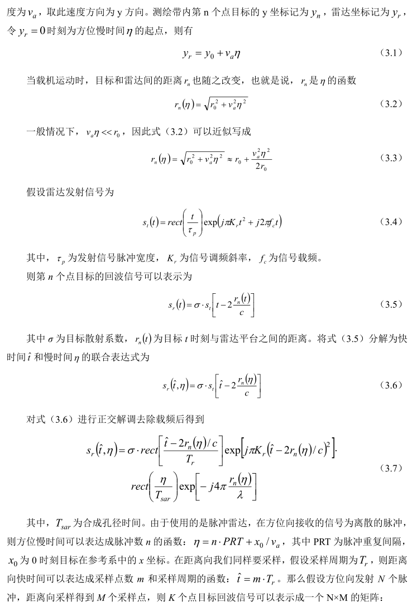
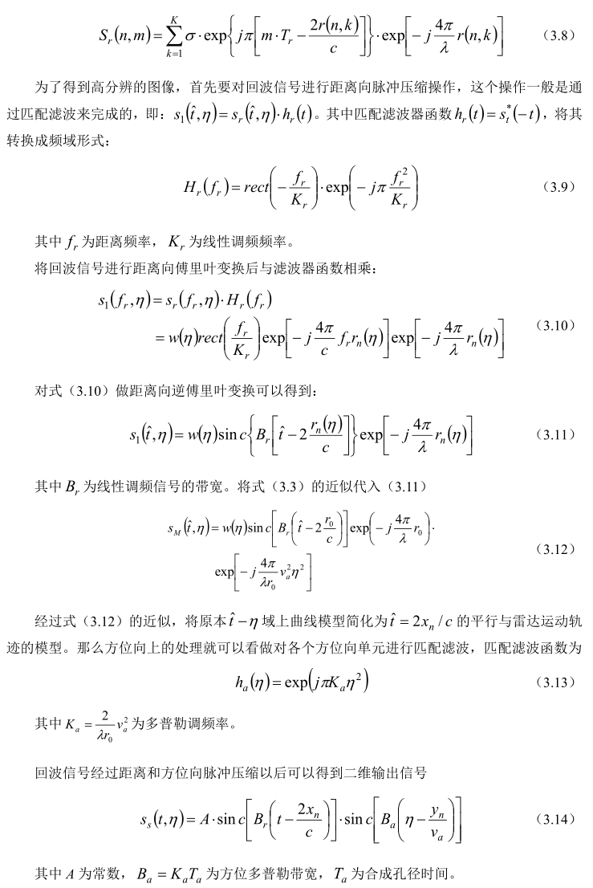
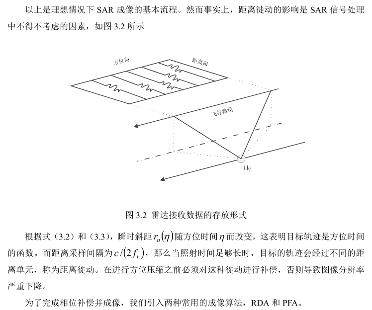
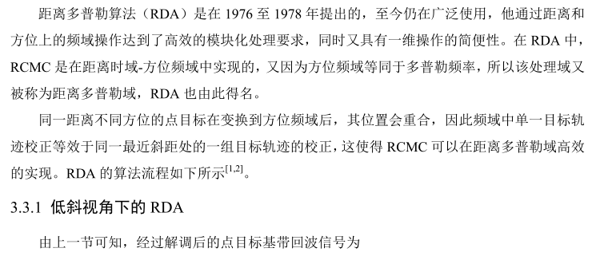
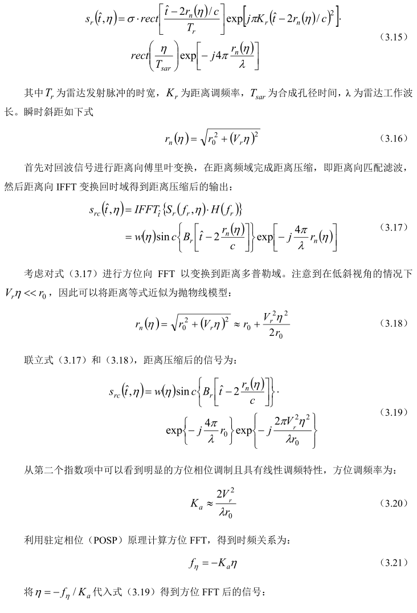
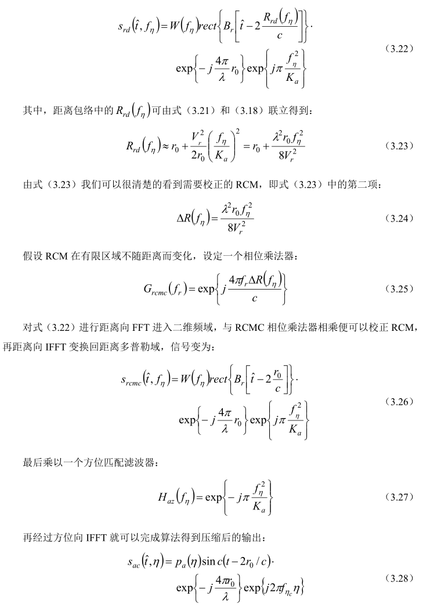
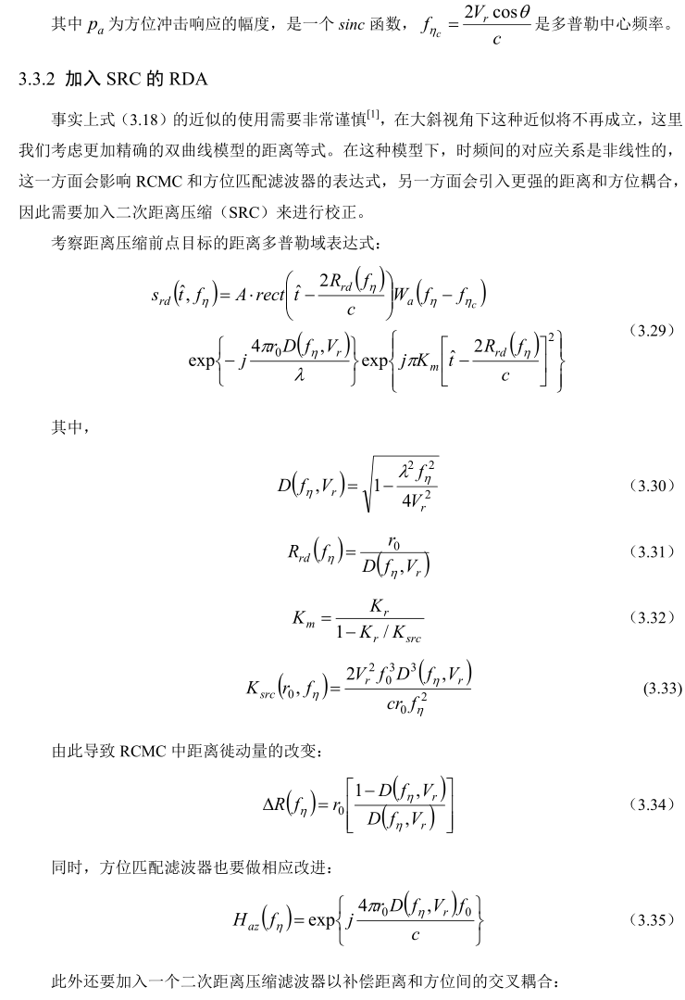
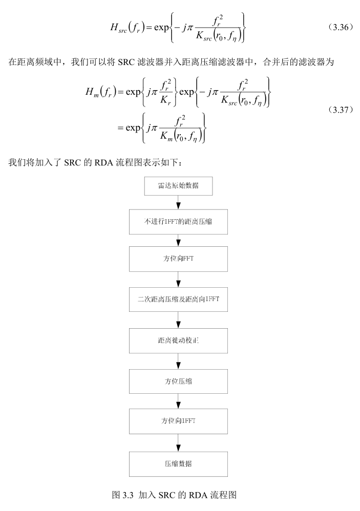
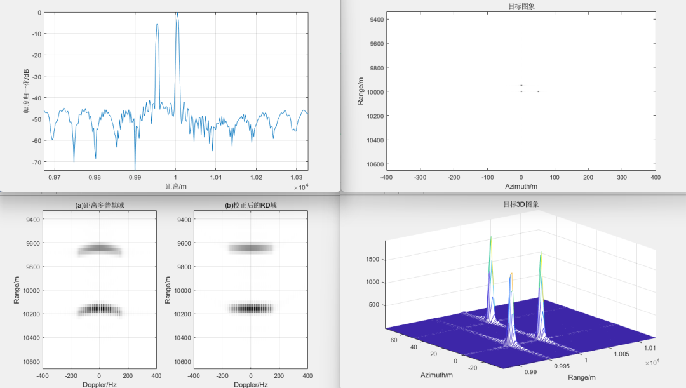

<!-- PAYMENT_BLOCK -->

## Get this dataset

- Payment link (Stripe): [Buy now](https://buy.stripe.com/3cs8yP7sY87d0vu9AB)
- Payment QR code: 

<!-- /PAYMENT_BLOCK -->
